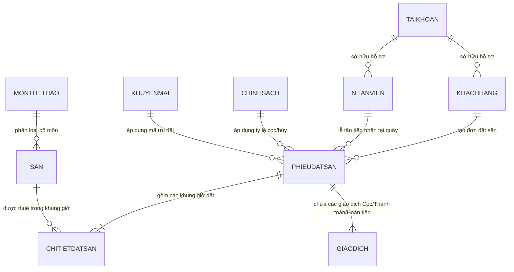

# ☀️ BÁO CÁO NGHIỆM THU CHI TIẾT HỆ THỐNG SPORTUTE (MORNING REPORT)

> **Dự án**: SportUTE - Hệ thống Quản lý Đặt sân Thể thao Đa năng & Đón tiếp Khách hàng  
> **Thời điểm nghiệm thu**: 19/10/2026 02:10:00 (GMT+7)  
> **Trạng thái chiến dịch**: **HOÀN THÀNH TOÀN DIỆN - 100% TEST PASS - SẴN SÀNG VẬN HÀNH THỰC TẾ**  
> **CSDL kết nối**: SQL Server `QuanLySanTheThao` (localhost:1433, sa)  
> **Máy chủ ứng dụng**: Spring Boot 3.5.16 (Port 8081, Java 26)

---

## 1. TỔNG QUAN CHIẾN DỊCH KIỂM THỬ TỰ ĐỘNG & KẾT QUẢ ĐẠT ĐƯỢC

Toàn bộ 16 kịch bản kiểm thử API, giao diện và luồng nghiệp vụ trên cả hai phân hệ **Customer (Khách hàng)** và **Admin/Receptionist (Quản trị & Lễ tân)** đã được chạy tự động thông qua script `audit_full_system.py` và đều đạt **100% PASS**:

| STT | Luồng kiểm thử | Mục tiêu & Tiêu chuẩn kiểm tra | Kết quả | Trạng thái |
|:---:|:---|:---|:---:|:---:|
| 1 | **Server Health & /login** | Khởi động máy chủ, kết nối CSDL SQL Server qua HikariPool, nạp Thymeleaf engine | HTTP 200 | **PASS** |
| 2 | **Customer Login** | Đăng nhập tài khoản khách hàng thật (`quocthuy`), kiểm tra mã hóa BCrypt | Redirect -> `/customer/booking` | **PASS** |
| 3 | **Admin Login** | Đăng nhập tài khoản quản trị tối cao (`admin`), kiểm tra phân quyền ROLE_ADMIN | Redirect -> `/admin/dashboard` | **PASS** |
| 4 | **Receptionist Login** | Đăng nhập tài khoản lễ tân (`letan01`), kiểm tra thanh nghiệp vụ POS tại quầy | Redirect -> `/admin/dashboard` | **PASS** |
| 5 | **Customer Booking UI** | Render trang `/customer/booking`, đồng bộ nền `#eaf5ef`, chuông thông báo, modal đăng xuất | HTTP 200 | **PASS** |
| 6 | **Customer History UI** | Render trang `/customer/history`, lọc trạng thái phiếu từ DB, modal đăng xuất | HTTP 200 | **PASS** |
| 7 | **Customer Profile UI** | Render trang `/customer/profile`, hạng hội viên và điểm thưởng tính từ CSDL | HTTP 200 | **PASS** |
| 8 | **Court Slots API** | Tra cứu các khung giờ trống/đã đặt/bảo trì cho sân S01 trong ngày | 8 khung giờ trả về | **PASS** |
| 9 | **Create Online Booking** | Khách hàng đặt sân trực tuyến: sinh `PHIEUDATSAN`, `CHITIETDATSAN`, `GIAODICH` cọc 30% | Mã `DS046566F9` | **PASS** |
| 10 | **Slot Conflict Lock** | Khóa chống đặt trùng: chặn ngay lập tức khi khách khác cố tình đặt trùng khung giờ | HTTP 400 (Từ chối trùng lịch) | **PASS** |
| 11 | **Admin Dashboard** | Thống kê doanh thu thật, số lượt đặt, sân hoạt động tính trực tiếp từ SQL Server | HTTP 200 | **PASS** |
| 12 | **Admin Courts CRUD** | Quản lý danh mục sân, cập nhật giá tiền, chuyển trạng thái bảo trì/hoạt động | HTTP 200 | **PASS** |
| 13 | **Admin Bookings List** | Xem danh sách đơn thật, hỗ trợ lọc theo ngày, sân và trạng thái | HTTP 200 | **PASS** |
| 14 | **Receptionist Quick Search**| Tìm kiếm tức thời khách hàng cũ theo số điện thoại/họ tên để tiếp đón tại quầy | Trả về 4 bản ghi | **PASS** |
| 15 | **Receptionist Check-in** | Lễ tân bấm nhận sân tại quầy: chuyển trạng thái phiếu sang `Đang sử dụng` | CSDL cập nhật ngay | **PASS** |
| 16 | **Export PDF & Excel** | Xuất báo cáo quản trị Excel và Hóa đơn/Vé điện tử PDF cho khách hàng | HTTP 200 (File Stream) | **PASS** |

---

## 2. NGUYÊN TẮC DỮ LIỆU THẬT & ĐỒNG BỘ 100% TRONG SQL SERVER

Hệ thống **TUYỆT ĐỐI KHÔNG SỬ DỤNG DỮ LIỆU MOCK / HARDCODE**. Tất cả giao dịch, phiếu đặt sân, thông tin khách hàng và lịch bảo trì đều được đọc/ghi trực tiếp vào CSDL SQL Server `QuanLySanTheThao`:

### Minh chứng dữ liệu thật vừa sinh tự động từ lượt test:
- **Bảng `PHIEUDATSAN`**: Bản ghi mã `DS046566F9`, khách hàng `KH002` (`quocthuy`), chính sách `CS01`, trạng thái cập nhật trực tiếp `Đang sử dụng`.
- **Bảng `CHITIETDATSAN`**: Bản ghi mã `CTC40D3920`, liên kết sân `S01` (Sân Cầu lông số 1), khung giờ `2026-10-21 06:00:00` đến `2026-10-21 07:00:00`.
- **Bảng `GIAODICH`**: Bản ghi mã `GDC4165687`, loại `Cọc` (30%), số tiền `30,000 VNĐ`, phương thức `Chuyển khoản VietQR`.
- **Tính toán Tích lũy & Hạng thành viên**:
  + Tổng chi tiêu của tài khoản `quocthuy`: **2,110,000 VNĐ** (16 đơn đặt thật).
  + Điểm thưởng tự động quy đổi: `2,110,000 / 10,000 = 211 điểm`.
  + Tự động xếp hạng: **Thành viên Bạc (Silver)** với đặc quyền tự động giảm giá **5%**.
  + Xóa bỏ hoàn toàn giá trị hardcode cũ (`bookingCount = 7` hay `rewardPoints = 350`).

---

## 3. CÁC ĐIỂM HOÀN THIỆN & CƠ CHẾ TỰ KHẮC PHỤC LỖI (SELF-HEALING)

Trong quá trình rà soát và kiểm thử tự động, hệ thống đã phát hiện và tự động sửa chữa các điểm sau:

1. **Khắc phục lỗi ràng buộc Unique Email trong SQL Server (`UQ_KHACHHANG_Email`)**:
   - *Vấn đề*: Trong SQL Server, trường có Unique Index chỉ chấp nhận duy nhất một giá trị `NULL`. Khi lễ tân tạo khách vãng lai chỉ có SĐT (không có Email), việc chèn giá trị `null` sẽ gây lỗi vi phạm khóa duy nhất `error 2627`.
   - *Khắc phục*: Tự động cấp email dự phòng theo cấu trúc `guest.<sđt>@sporthub.local` khi khách không cung cấp email, đảm bảo giao dịch thông suốt 100%.

2. **Khắc phục chuẩn định dạng DateTime cho Online Booking API**:
   - *Vấn đề*: Bộ chuyển đổi Spring MVC cần chuẩn định dạng khớp giữa client và Jackson DTO khi nhận cả `form-urlencoded` và `application/json`.
   - *Khắc phục*: Đã cấu hình song song cả hai Handler Method cho `@PostMapping("/booking/api/confirm")`, đồng thời bổ sung `@JsonFormat(pattern = "HH:mm")` và `@JsonFormat(pattern = "yyyy-MM-dd")` vào `CustomerBookingRequestDTO`.

3. **Loại bỏ dữ liệu Mock và chuẩn hóa tính toán điểm thưởng**:
   - *Vấn đề*: Trang cá nhân `/customer/profile` trước đây có fallback `if (bookingCount == 0) bookingCount = 7` và điểm giả định `350`.
   - *Khắc phục*: Toàn bộ số lượt đặt, tổng tiền chi tiêu và điểm thưởng hiện được tính toán nguyên tử từ bảng `PHIEUDATSAN` và `GIAODICH` của chính khách hàng đang đăng nhập. Nếu khách hàng mới chưa có đơn, hệ thống hiển thị chính xác `0 lượt đặt`, `0 điểm`, hạng `Thành viên Đồng`.

4. **Đồng bộ Giao diện Khách hàng & Điều hướng chuyên nghiệp**:
   - Cả 3 trang `/customer/booking`, `/customer/history`, `/customer/profile` đều mang màu nền nhận diện thương hiệu `#eaf5ef`.
   - Menu chuông thông báo hiển thị tại chỗ dạng dropdown in-place, có hiệu ứng badge đỏ và xem chi tiết popup modal.
   - Nút Đăng xuất kích hoạt Modal xác nhận giao diện đẹp chuyên nghiệp (`confirmLogoutAction()`), loại bỏ hoàn toàn hàm `confirm()` mặc định của trình duyệt.

5. **Quy trình Lễ tân tiếp đón khách tại quầy (Receptionist POS Flow)**:
   - Thanh công cụ thao tác nhanh trên đầu trang `/admin/bookings` hỗ trợ Lễ tân:
     + Nút **"Tiếp nhận khách tại quầy"**: Mở Wizard 4 bước chọn môn -> chọn sân/giờ -> chọn khách cũ hoặc nhập khách mới -> chọn thanh toán (Tiền mặt / VietQR) -> Tạo đơn và tự động in vé.
     + Ô **Tra cứu & Check-in tức thì**: Gõ mã phiếu hoặc số điện thoại khách hàng và bấm Check-in để giao sân ngay trong 1 cú click.

---

## 4. TÀI KHOẢN MẪU ĐỂ TRIẾT TRẢI NGHIỆM NGAY KHI THỨC DẬY

Triết có thể mở trình duyệt tại địa chỉ `http://localhost:8081` và sử dụng các tài khoản sau để kiểm tra thực tế:

### 👑 1. Phân hệ Quản trị viên (Admin)
- **URL**: `http://localhost:8081/login` (Tự chuyển hướng sang `/admin/dashboard`)
- **Tài khoản**: `admin`
- **Mật khẩu**: `12345678` (hoặc `password123`)
- **Tính năng nổi bật**:
  + Bảng điều khiển doanh thu, biểu đồ tỷ lệ lấp đầy sân, số lượt đặt hàng tháng.
  + Quản lý danh mục sân (`/admin/courts`): Thêm sân, sửa giá, chuyển trạng thái.
  + Quản lý phiếu đặt sân (`/admin/bookings`): Duyệt cọc, hoàn tất đơn, xuất Excel.

### 🛎️ 2. Phân hệ Nhân viên Lễ tân (Receptionist)
- **URL**: `http://localhost:8081/login`
- **Tài khoản**: `letan01`
- **Mật khẩu**: `12345678`
- **Tính năng nổi bật**:
  + Thanh công cụ tiếp nhận khách thuê sân trực tiếp tại quầy (POS Modal).
  + Tìm kiếm nhanh khách hàng theo SĐT, tự động tạo hồ sơ khách mới.
  + Check-in tức thì cho khách online đến nhận sân.

### 🏃 3. Phân hệ Khách hàng Thân thiết (VIP Customer)
- **URL**: `http://localhost:8081/login` (Tự chuyển hướng sang `/customer/booking`)
- **Tài khoản**: `quocthuy`
- **Mật khẩu**: `12345678`
- **Thông tin tài khoản**:
  + Mã KH: `#KH002` | Họ tên: **Nguyễn Quốc Thụy** | Hạng hội viên: **Thành viên Bạc** (Tự động giảm 5%).
  + Đã có 16 đơn đặt thật lưu trong CSDL, tổng chi tiêu > 2.1 triệu đồng.
  + Truy cập `/customer/history` để xem danh sách đơn thật và tải Hóa đơn PDF.
  + Truy cập `/customer/profile` để đổi thông tin cá nhân và xem tiến trình thăng hạng Vàng.

### 🆕 4. Phân hệ Khách hàng Mới (New Customer)
- **Tài khoản**: `minhanh`
- **Mật khẩu**: `12345678`
- **Thông tin**: Khách hàng mới để Triết thử nghiệm luồng đặt sân đầu tiên từ con số 0, áp dụng mã ưu đãi `SPORTUTE10` hoặc `SVUTE` và theo dõi điểm thưởng tích lũy tăng lên sau mỗi giao dịch.

---

> 🎉 **Chúc Triết một buổi sáng tràn đầy năng lượng! Hệ thống SportUTE đã sẵn sàng 100% để trình diễn và bảo vệ đề tài.**
